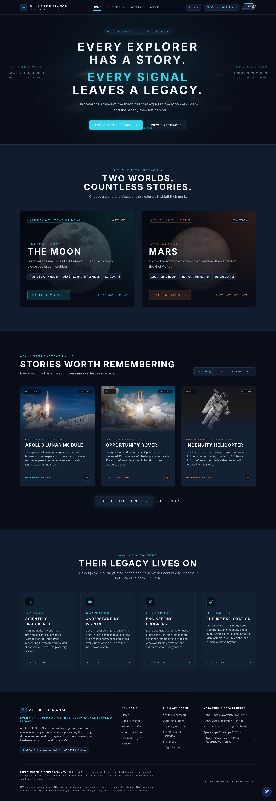
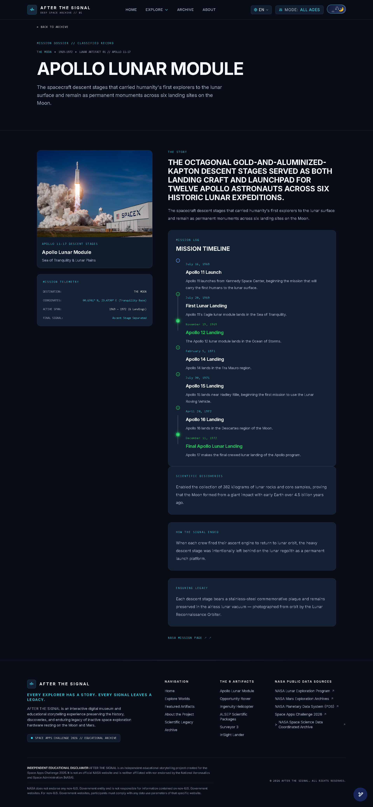
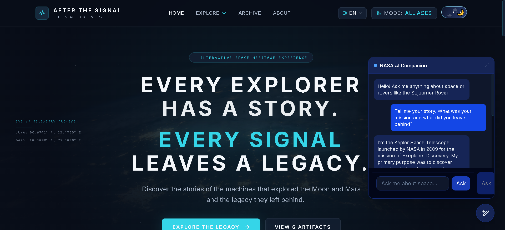

<div align="center">

# 🛰️ After The Signal

**Every Explorer Has a Story. Every Signal Leaves a Legacy.**

An interactive space-heritage experience that tells the stories of the machines we left on the Moon, Mars and deep space, and the legacy they left behind.

[**🌐 Live Demo**](https://after-the-signal-roan.vercel.app) · Built for **NASA Space Apps Challenge 2026**


</div>

---

## 📸 Preview

### Home


### Artifact Story


### AI Assistant


---

## 🌌 About the Project

Thousands of pieces of hardware have been left behind on the Moon, Mars and in deep space. Most people never hear their stories.

**After The Signal** turns these machines into characters. Instead of dry technical archives, visitors explore each artifact's mission, discoveries and legacy in an engaging, easy-to-follow experience designed for **school-age learners and casual space fans**.

This project was built for the **NASA Space Apps Challenge 2026** (challenge: *telling the story of hardware left on the Moon, Mars and deep space*).

---

## ✨ Features

- 🏠 **Home**: a cinematic landing page introducing the experience
- 🔭 **Explore**: browse artifacts from the Moon and Mars
- 📖 **Artifact Stories**: a dedicated story page for each machine, covering its mission, discoveries and legacy
- 🗂️ **Archive**: a catalog of the explored artifacts
- 🤖 **AI Assistant ("Ask the Explorer")**: ask questions and hear the story from the machine's point of view
- 🌍 **Multi-language** support (EN toggle in the navbar)
- 🎚️ **Audience modes**: content adapted for different ages (*Mode: All Ages*)
- 📱 Responsive design for desktop, tablet and mobile

---

## 🛠️ Tech Stack

| Layer      | Technology                              |
| ---------- | --------------------------------------- |
| Frontend   | Angular, TypeScript, Tailwind CSS       |
| Data       | Static JSON                             |
| Backend    | .NET (optional / in progress)           |
| Deployment | Vercel                                  |

---

## 📁 Project Structure

```
After-The-Signal/
├── frontend/
│   └── After-The-Signal/        # Angular application
│       └── src/app/
│           ├── core/
│           ├── shared/          # navbar, footer, loading
│           └── features/
│               ├── home/
│               ├── explore/
│               ├── artifact-story/
│               ├── ai-assistant/
│               └── about/
└── backend/                     # .NET API (optional)
```

---

## 🚀 Getting Started

### Prerequisites

- [Node.js](https://nodejs.org/) (LTS version, 22.x or 24.x recommended)
- [Angular CLI](https://angular.dev/tools/cli)

```bash
npm install -g @angular/cli
```

### Run locally

```bash
# 1. Clone the repository
git clone https://github.com/Joe-Elkilani/After-The-Signal.git

# 2. Go to the Angular app
cd After-The-Signal/frontend/After-The-Signal

# 3. Install dependencies
npm install

# 4. Start the dev server
ng serve
```

Then open **http://localhost:4200** in your browser.

### Production build

```bash
ng build
```

The output is generated in `dist/after-the-signal/browser`.

---

## ☁️ Deployment

The app is deployed on **Vercel** with these settings:

- **Root Directory:** `frontend/After-The-Signal`
- **Framework Preset:** Angular
- **Output Directory:** `dist/after-the-signal/browser`

Every push to `main` triggers a new production deployment automatically.

---
## 🚧 Future Improvements

- 🛰️ Add more artifacts from the Moon, Mars and deep space, such as rovers, landers and probes
- 🌍 Support more languages (Arabic first) to reach more learners
- 🤖 Ground the AI Assistant in official NASA mission data for more accurate answers
- 🎚️ Expand the audience modes with content tailored to kids, students and enthusiasts
- 🔊 Add audio narration and interactive timelines for each artifact story
- ♿ Improve accessibility (keyboard navigation, screen-reader support)

---
## 👥 Team

Built in 3 days by a team of 5 during NASA Space Apps Challenge 2026.

| Name | Role |
| ---- | ---- |
| [**Yousef Ahmed**](https://github.com/Joe-Elkilani) | Angular Frontend |
| [**Hammad Amr**](https://github.com/hammadhammadamr-create) | Frontend |
| [**Yassin Ibrahim**](https://github.com/yassinbrakallaa-debug) | Frontend |
| [**Mohamed Bassem**](https://github.com/Mohammed710333) | Backend (.NET) |
| [**Marwan Mohamed**](...) | AI |

---

## 🙏 Acknowledgements

- [NASA Space Apps Challenge](https://www.spaceappschallenge.org/) for the challenge and inspiration
- NASA and the space agencies whose public data and mission archives make these stories possible

---

## 📄 License

This project is licensed under the MIT License.
